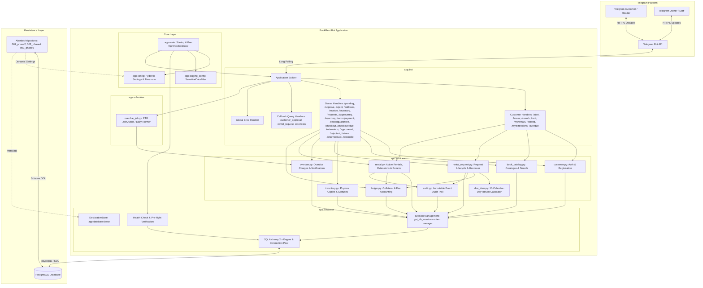

# BookRent Bot — Architecture Blueprint (Phases 1–6)

## 1. System Overview

**BookRent Bot** is a production-grade Telegram-based book rental management system engineered for high reliability, financial auditability, concurrency safety, and strict separation of concerns.

The architecture spans six completed implementation phases:
- **Phase 1: Foundation**: Modular layout, environment-driven Pydantic configuration with automatic secret redaction, production-grade SQLAlchemy connection pooling, health checks, structured logging filters, and Alembic migrations.
- **Phase 2: Data Models & Inventory Foundations**: SQLAlchemy ORM models (`Book`, `BookCopy`, `Customer`, `Rental`, `RentalExtension`, `CollateralLedger`, `AuditLog`), canonical ISBN-10/13 normalization, physical inventory transitions, and financial ledger models.
- **Phase 3: Customer Registration, Owner Cataloguing & Inventory**: Telegram customer self-registration (`/start` -> `PENDING`), owner review (`/pending`, `/approve`, `/reject`), owner book cataloguing (`/addbook`), stock receiving (`/receive`), inventory inspection (`/inventory`), and catalogue discovery (`/books`, `/search`).
- **Phase 4: Rental Requests, Owner Approval, Payment/Collateral Verification, and Physical Checkout**:
  - Separate pre-rental request lifecycle (`RentalRequest`) from physical checkout (`Rental`).
  - Owner-only approval and rejection workflows with atomic copy reservation (`ON_SHELF` -> `RESERVED`).
  - Strict financial separation between rental fees, monetary collateral deposits, and non-cash guarantees.
  - Manual verification of cash and bank transfers (uploaded receipts are never treated as proof of payment).
  - Configurable rental timezone and dedicated `due_date.py` service implementing the 10-calendar-day end-of-day convention.
  - Owner-only physical handover confirmation activating the rental (`RESERVED` -> `RENTED`).
  - Idempotency safeguards against duplicate callbacks and clicks.
- **Phase 5: Overdue Management, Extensions, Returns & Scheduling**:
  - Daily overdue detection generating deterministic 5.00 ETB/day charges under unique constraint `(rental_id, overdue_date)`.
  - Independent customer and owner Telegram overdue notifications with retry safety without duplicate billing.
  - 5-calendar-day rental extension requests (`/extend`) costing a fixed 10.00 ETB fee, with owner verification (`/approveext`).
  - Owner-confirmed physical returns (`/return`, `/returndeduct`) recording book condition (`ON_SHELF`, `DAMAGED`, `LOST`), condition notes, collateral deductions, and automatic refunds of remaining balances.
  - Collateral ledger reconciliation: `Total Deposits = Deductions + Refunds + Net Balance`.
  - Persistent, restart-safe daily background scheduler (`overdue_job.py`).
- **Phase 6: Production Readiness, Integration Testing & Deployment**:
  - Live PostgreSQL integration test suite verifying table constraints, row-level locking, and transactional rollbacks.
  - Alembic migrations (001, 002, 003) verified across both SQLite and live PostgreSQL (upgrade and downgrade).
  - Duplicate scheduler registration guards.
  - Validated backup and restore runbook (`pg_dump` and `psql`).
  - Production environment configuration and operational deployment guides.

---

## 2. System Architecture Diagram



---

## 3. Financial and Inventory State Machines

### 3.1. Rental Request & Physical Handover
```
[SUBMITTED] -> [APPROVED (Copy RESERVED)] -> [FEE & COLLATERAL VERIFIED] -> [COMPLETED (Copy RENTED, Rental ACTIVE)]
     |                      |
     v                      v
 [REJECTED]            [CANCELLED] (Releases copy to ON_SHELF)
```

### 3.2. Rental Overdue, Extension & Return Lifecycle
```
[Rental ACTIVE] ──(Due Date Passed)──> [Overdue: Daily 5 ETB Charged via DB Unique Constraint]
       │                                                      │
       ├────(Customer /extend)──> [Extension REQUESTED]        │
       │                                │                     │
       │                   (Owner /approveext + 10 ETB)       │
       │                                │                     │
       │                                v                     │
       │                         [New Due Date (+5d)] <───────┘
       │
       └────(Owner /return or /returndeduct)
                    │
                    ├── Book Condition: ON_SHELF / DAMAGED / LOST
                    ├── Deductions Recorded: CollateralLedger (DEDUCTION)
                    ├── Remaining Collateral: CollateralLedger (REFUND)
                    └── [Rental RETURNED, Copy Updated, Final Balance 0.00 ETB]
```

---

## 4. Security, Concurrency & Data Integrity Guarantees

1. **Deterministic Overdue Billing**: Backed by `uq_overdue_charges_rental_date (rental_id, overdue_date)` unique constraint. Re-running the scheduler catches up unbilled missed days idempotently and never double-bills.
2. **Atomic Row-Level Locking**: `with_for_update()` prevents race conditions when allocating copies, processing payments, or confirming returns.
3. **Partial Unique Index on Active Rentals**: Prevents physical copies from being rented more than once simultaneously.
4. **Isolated Collateral Accounting**: Non-cash guarantees (IDs, passports) are never converted into cash ledger balances. Cash deposits are held until return deduction or refund.
5. **Decoupled Delivery & Financial Operations**: Charges are committed prior to sending Telegram notifications; Telegram API timeouts or blocked users never corrupt ledger transactions.
6. **Zero Credential Leakage**: `SecretStr` configuration with automated masking prevents bot tokens and database passwords from appearing in logs or error messages.
